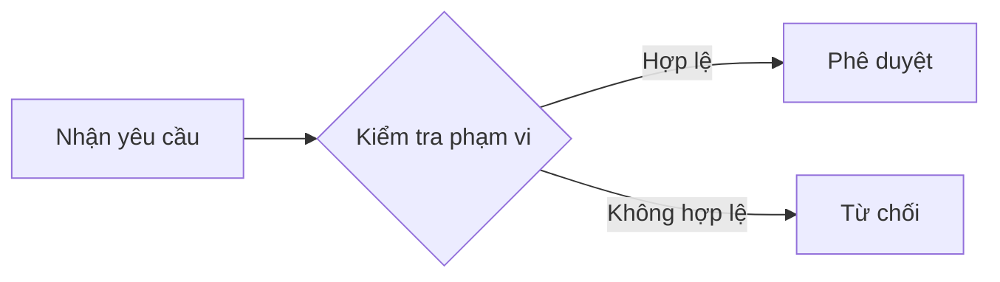

# Quy trình phê duyệt yêu cầu

## Mục tiêu nghiệp vụ

Đảm bảo yêu cầu được người có thẩm quyền xem xét trong phạm vi dữ liệu được phép. Đây là quy trình demo.

## Tác nhân và trigger

Người quản lý phòng ban nhận một yêu cầu ở trạng thái Pending. Yêu cầu cần có đủ thông tin và được gán đúng phòng ban.

## Các bước xử lý

## Tóm tắt luồng

Tác nhân: ROLE-MANAGER. Trigger: yêu cầu chờ xử lý. Người quản lý mở SCR-APP-001 và kiểm tra BR-014. Nếu đúng phạm vi và đủ thông tin, thực hiện FUNC-APP-003 để chuyển sang Approved. Nếu không đủ điều kiện, từ chối và ghi lý do. Kết quả: một quyết định có thể truy vết.

## Ngoại lệ

- Yêu cầu đã được xử lý ở tab khác: tải lại trạng thái mới.
- Ngoài phạm vi phòng ban: không cho phép phê duyệt.
