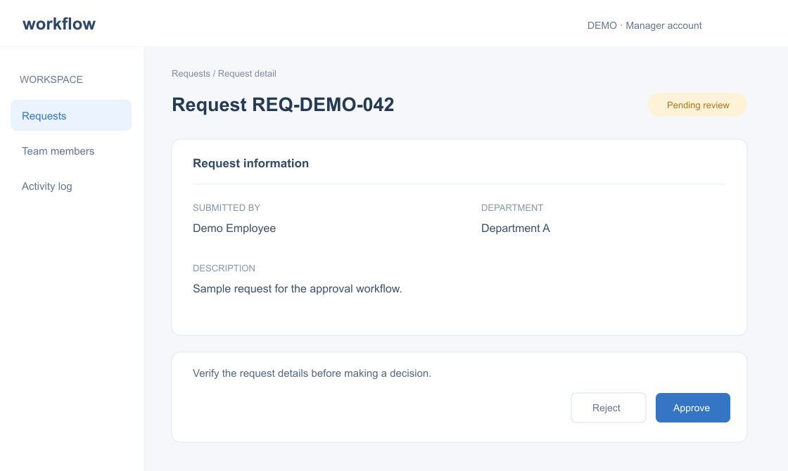

# Chi tiết yêu cầu phê duyệt

## Mục đích

Giúp người quản lý kiểm tra thông tin và quyết định xử lý yêu cầu. Mọi dữ liệu và tên người trong hình đều là minh họa.

## Cách truy cập

Home → Requests → Request Detail. Chọn một yêu cầu trong danh sách. URL minh họa: `/requests/:id`.

## Hình ảnh màn hình

## Thành phần giao diện

| Thành phần | Mô tả | Validation | Function ID |
| --- | --- | --- | --- |
| Thông tin yêu cầu | Người tạo, phòng ban, ngày gửi | Chỉ đọc | — |
| Approve | Phê duyệt yêu cầu | Pending và đúng phạm vi | FUNC-APP-003 |
| Reject | Từ chối kèm lý do | Bắt buộc nhập lý do | — |

## Vai trò và quyền

ROLE-MANAGER được xem yêu cầu trong phòng ban được gán. Quyền phê duyệt phụ thuộc BR-014 và trạng thái Pending; quyền xem không tự động bao gồm quyền chỉnh sửa.

## Trạng thái màn hình

- Loading: đang tải thông tin.
- Empty: không có yêu cầu.
- Error: không đủ quyền hoặc tài liệu không còn tồn tại.
- Success: hiển thị quyết định mới nhất.

## Ngoại lệ

API phải kiểm tra quyền lại khi thực hiện thao tác, kể cả khi nút đang hiển thị. Xung đột trạng thái trả lỗi để người dùng tải lại.

## Kiểm thử liên quan

Đọc [TC-APP-001](/test-scenarios/approval/TC-APP-001/) để kiểm tra case positive, negative và boundary.
