# Hướng dẫn sử dụng Atlas

Atlas là kho tri thức nghiệp vụ dùng chung cho BA, Dev và QA. Mọi người tra cứu màn hình, chức năng, quy tắc và quy trình ở cùng một chỗ. Nhóm biên tập cập nhật tài liệu qua bản nháp, gửi duyệt rồi mới xuất bản, nên người đọc luôn thấy bản đã được xác nhận.

Ảnh minh họa có khung đỏ đánh dấu chỗ cần bấm. Bấm vào ảnh để xem cỡ lớn.

## Mục lục

**Bắt đầu**

- [1. Đăng nhập và quyền](#1-đăng-nhập-và-quyền)
- [2. Trang Tổng quan và thanh bên](#2-trang-tổng-quan-và-thanh-bên)
- [3. Chọn project làm việc](#3-chọn-project-làm-việc)
- [4. Tìm kiếm nhanh (Ctrl + K)](#4-tìm-kiếm-nhanh-ctrl--k)

**Tra cứu**

- [5. Màn hình nghiệp vụ](#5-màn-hình-nghiệp-vụ)
- [6. Đọc một tài liệu](#6-đọc-một-tài-liệu)
- [7. Góp ý nội dung](#7-góp-ý-nội-dung)
- [8. Function ID & Quy ước](#8-function-id--quy-ước)
- [9. Thư viện tài liệu](#9-thư-viện-tài-liệu)

**Biên tập** (Editor, Publisher, Admin)

- [10. Tạo tài liệu mới](#10-tạo-tài-liệu-mới)
- [11. Soạn nội dung](#11-soạn-nội-dung)
- [12. Chèn ảnh](#12-chèn-ảnh)
- [13. Liên kết tài liệu bằng @](#13-liên-kết-tài-liệu-bằng-)
- [14. Liên kết chức năng cho màn hình](#14-liên-kết-chức-năng-cho-màn-hình)
- [15. Lưu bản nháp và gửi duyệt](#15-lưu-bản-nháp-và-gửi-duyệt)

**Duyệt và quản lý** (Publisher, Admin)

- [16. Duyệt và xuất bản](#16-duyệt-và-xuất-bản)
- [17. Lịch sử phiên bản](#17-lịch-sử-phiên-bản)
- [18. Sơ đồ nâng cao](#18-sơ-đồ-nâng-cao)
- [19. Chất lượng và truy vết](#19-chất-lượng-và-truy-vết)
- [20. Cấu hình không gian (Admin)](#20-cấu-hình-không-gian-admin)
- [21. Lưu ý khi làm việc nhóm](#21-lưu-ý-khi-làm-việc-nhóm)

## 1. Đăng nhập và quyền

**Công dụng:** xác định bạn là ai và bạn được làm gì trong Atlas.

1. Mở địa chỉ Atlas do quản trị viên cung cấp (bản chạy trên máy: **http://127.0.0.1:5173**).
2. Nhập **Tài khoản** và **Mật khẩu**, rồi bấm **Đăng nhập**.

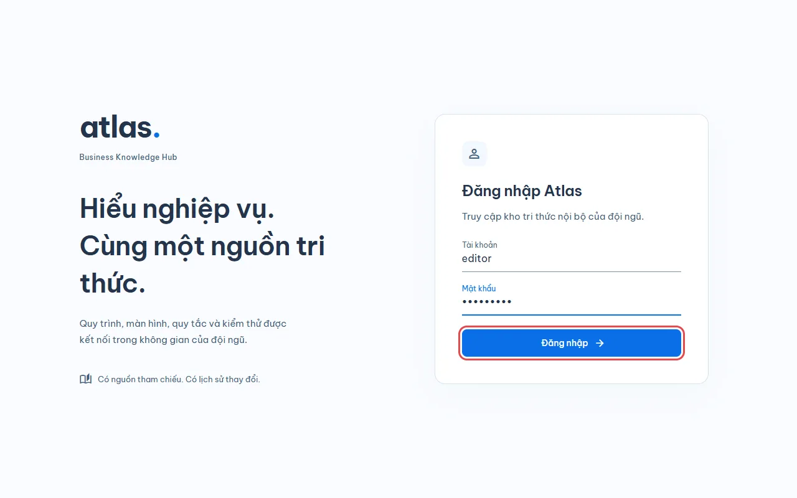

Mỗi tài khoản có một quyền:

| Quyền | Làm được gì |
| --- | --- |
| Reader | Đọc tài liệu đã xuất bản, tìm kiếm, export và gửi góp ý |
| Editor | Thêm: tạo và sửa bản nháp, vẽ sơ đồ, gửi duyệt |
| Publisher | Thêm: duyệt, xuất bản, khôi phục và gỡ xuất bản |
| Admin | Toàn bộ quyền trên, cộng với cấu hình không gian |

Để đăng xuất hoặc mở lại hướng dẫn này, bấm vào tên của bạn ở góc phải trên cùng.

## 2. Trang Tổng quan và thanh bên

**Công dụng:** điểm bắt đầu mỗi ngày: tài liệu mới cập nhật, việc đang chờ bạn và các điểm cần chú ý.

- **Bạn đang cần hiểu điều gì?**: ô tìm kiếm nhanh, giống phím **Ctrl + K**.
- **Gần cập nhật**: các tài liệu vừa được xuất bản.
- **Việc của tôi** (Editor trở lên): bản nháp bạn đã lưu; với Publisher và Admin, có thêm các bản đang chờ bạn duyệt.
- **Cần chú ý**: số bản đang chờ duyệt, cần chỉnh sửa và quá hạn rà soát.

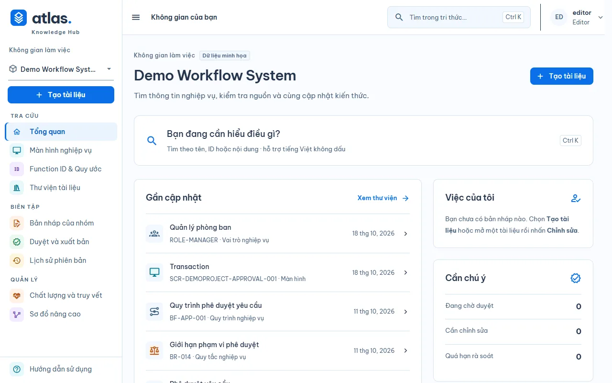

Thanh bên bên trái chia theo việc cần làm:

| Nhóm | Mục | Ai thấy |
| --- | --- | --- |
| **Tra cứu** | Tổng quan, Màn hình nghiệp vụ, Function ID & Quy ước, Thư viện tài liệu | Mọi người |
| **Biên tập** | Nút **Tạo tài liệu**, Bản nháp của nhóm, Duyệt và xuất bản, Lịch sử phiên bản | Editor, Publisher, Admin |
| **Quản lý** | Chất lượng và truy vết, Sơ đồ nâng cao, Cấu hình không gian (chỉ Admin) | Editor, Publisher, Admin |

**Hướng dẫn sử dụng** luôn nằm ở cuối thanh bên. Trên màn hình nhỏ, bấm nút ☰ ở góc trái trên để mở hoặc đóng thanh bên.

## 3. Chọn project làm việc

**Công dụng:** mỗi project là một hệ thống hoặc sản phẩm riêng. Chọn project để chỉ thấy tài liệu của hệ thống bạn đang làm.

1. Bấm ô **Không gian làm việc** ở đầu thanh bên.
2. Chọn project trong danh sách.

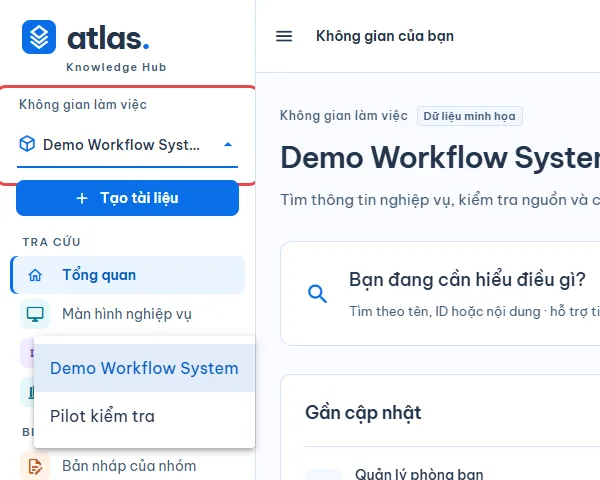

Atlas nhớ project bạn chọn cho lần đăng nhập sau. Chọn project chỉ đổi ngữ cảnh làm việc, không giới hạn quyền xem.

## 4. Tìm kiếm nhanh (Ctrl + K)

**Công dụng:** tìm một tài liệu bất kỳ theo tên, mã (ID) hoặc nội dung mà không cần biết nó nằm ở đâu.

1. Nhấn **Ctrl + K** (máy Mac: **Cmd + K**) ở bất kỳ trang nào, hoặc bấm ô **Tìm trong tri thức…** trên thanh trên cùng.
2. Gõ từ khóa. Có thể gõ tiếng Việt không dấu, ví dụ `phe duyet`.
3. Lọc thêm theo **Loại tài liệu** hoặc **Ngôn ngữ** nếu cần.
4. Dùng phím ↑ ↓ để chọn, **Enter** để mở, **Esc** để đóng.

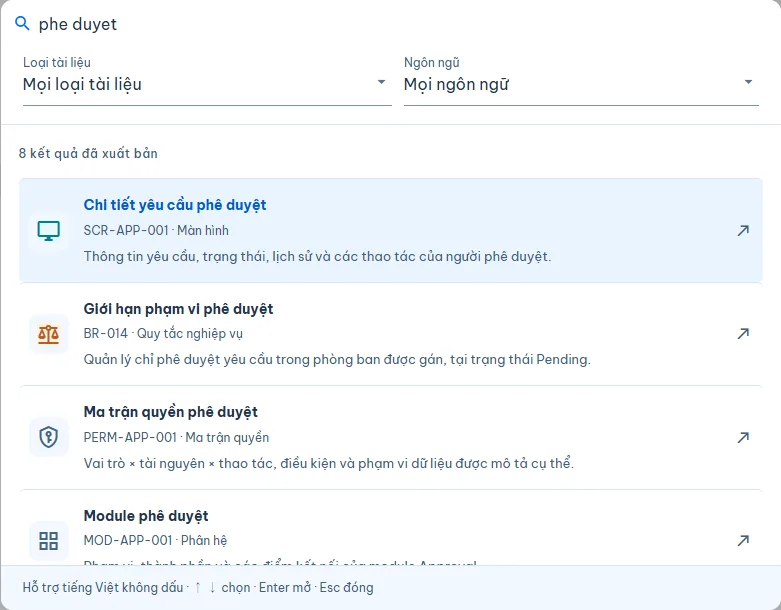

## 5. Màn hình nghiệp vụ

**Công dụng:** danh sách mọi màn hình của hệ thống, kèm số chức năng trên từng màn hình. Đây là cách nhanh nhất để biết một màn hình làm gì.

1. Bấm **Màn hình nghiệp vụ** ở thanh bên.
2. Dùng khay bộ lọc phía trên để thu hẹp: tìm theo tên màn hình, Screen ID hoặc Function ID; lọc theo **Project**, **Phân hệ**, **Nhãn**, **Vai trò**.
3. Chọn **Sắp xếp** (mới cập nhật, tên A–Z, phù hợp nhất) và kiểu hiển thị danh sách hoặc thẻ.
4. Bấm vào Screen ID hoặc tên màn hình để mở tài liệu.

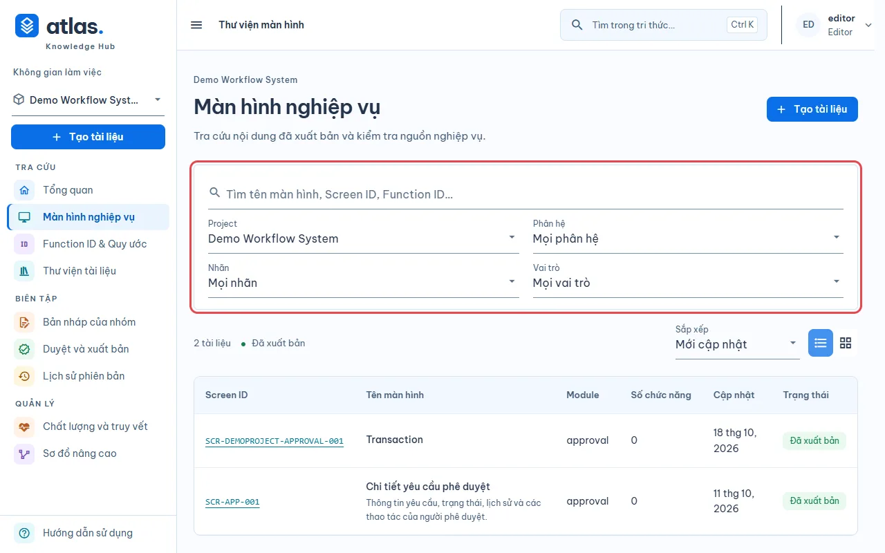

## 6. Đọc một tài liệu

**Công dụng:** xem đầy đủ một màn hình, chức năng, quy tắc hay quy trình: nội dung, hình ảnh, sơ đồ, người phụ trách và các tài liệu liên quan.

- Phần đầu trang cho biết mã tài liệu, trạng thái, người phụ trách, ngày cập nhật và phiên bản.
- **Mục lục** giúp nhảy nhanh tới từng phần.
- Bấm vào ảnh để xem cỡ lớn. Sơ đồ có nút phóng to, thu nhỏ, vừa khung, sao chép source và toàn màn hình.
- Cuối trang là **Tài liệu liên quan**: các màn hình, chức năng, quy tắc liên kết tới tài liệu này.

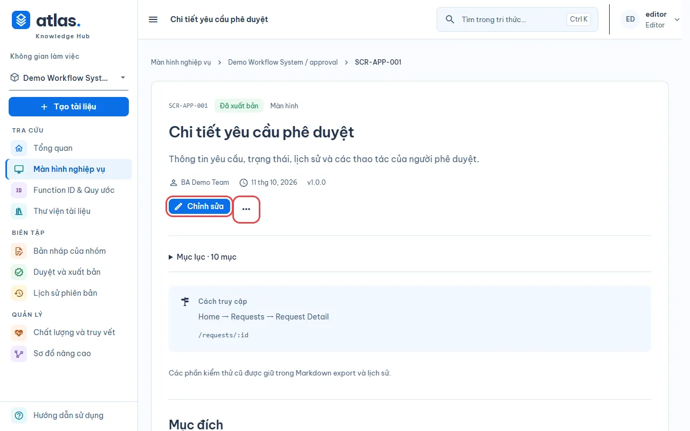

Nút **Chỉnh sửa** (Editor trở lên) mở bản nháp của tài liệu. Nút **…** (Thao tác tài liệu) có thêm:

| Thao tác | Công dụng |
| --- | --- |
| Lịch sử phiên bản | Xem các lần xuất bản trước của tài liệu |
| Sơ đồ nâng cao | Mở sơ đồ của tài liệu trong trình vẽ |
| Export Markdown | Tải nội dung về dạng file `.md` |
| Export đầy đủ | Tải file ZIP gồm nội dung và toàn bộ ảnh, sơ đồ |
| Góp ý nội dung | Báo cho nhóm biên tập phần cần sửa |

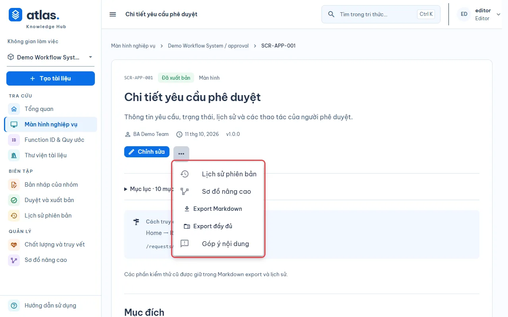

## 7. Góp ý nội dung

**Công dụng:** người đọc (kể cả Reader) báo cho nhóm biên tập khi thấy thông tin chưa rõ hoặc đã cũ, mà không cần sửa tài liệu.

1. Trong trang tài liệu, bấm **…** rồi chọn **Góp ý nội dung**.
2. Mô tả ngắn phần cần sửa và lý do.
3. Bấm **Gửi góp ý**.

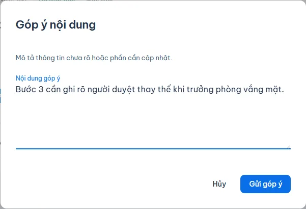

Góp ý hiện trong **Chất lượng và truy vết** để nhóm biên tập xử lý (xem [mục 19](#19-chất-lượng-và-truy-vết)).

## 8. Function ID & Quy ước

**Công dụng:** danh sách mọi chức năng (Function) theo mã nghiệp vụ, và tài liệu quy ước cách đặt mã. Dùng khi cần biết một Function ID thuộc màn hình nào.

1. Bấm **Function ID & Quy ước** ở thanh bên.
2. Khung **Tài liệu quy ước** ở trên cùng hiển thị quy tắc đặt mã đang áp dụng. Nếu project chưa có, Editor có thể bấm **Chuẩn bị bản nháp quy ước** để bắt đầu.
3. Trong **Danh sách chức năng**, tìm theo Function ID, tên chức năng hoặc Screen ID; lọc theo **Project**, **Module**, **Screen**.
4. Bật **Nhóm theo màn hình** để xem chức năng gom theo từng màn hình. Chức năng chưa gắn với màn hình nằm ở nhóm **Chưa liên kết Screen**.

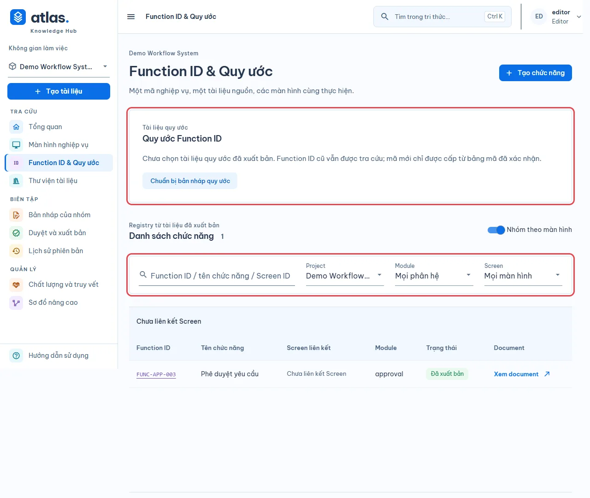

Nút **Tạo chức năng** mở ngay hộp tạo tài liệu với loại Chức năng.

## 9. Thư viện tài liệu

**Công dụng:** xem mọi loại tài liệu đã xuất bản (quy trình, quy tắc, vai trò, phân hệ, tài liệu tham chiếu…) ở một nơi.

1. Bấm **Thư viện tài liệu** ở thanh bên.
2. Tìm và lọc bằng khay bộ lọc như ở [mục 5](#5-màn-hình-nghiệp-vụ).
3. Đổi kiểu hiển thị bằng hai nút ở bên phải: **danh sách** để xem nhiều dòng, **thẻ** để thấy ảnh đại diện.

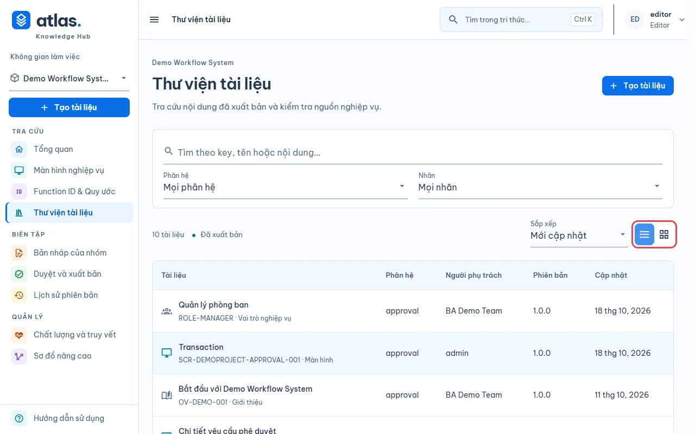

Ở dạng thẻ, ảnh đầu tiên trong nội dung được dùng làm ảnh đại diện. Atlas nhớ kiểu hiển thị bạn chọn.

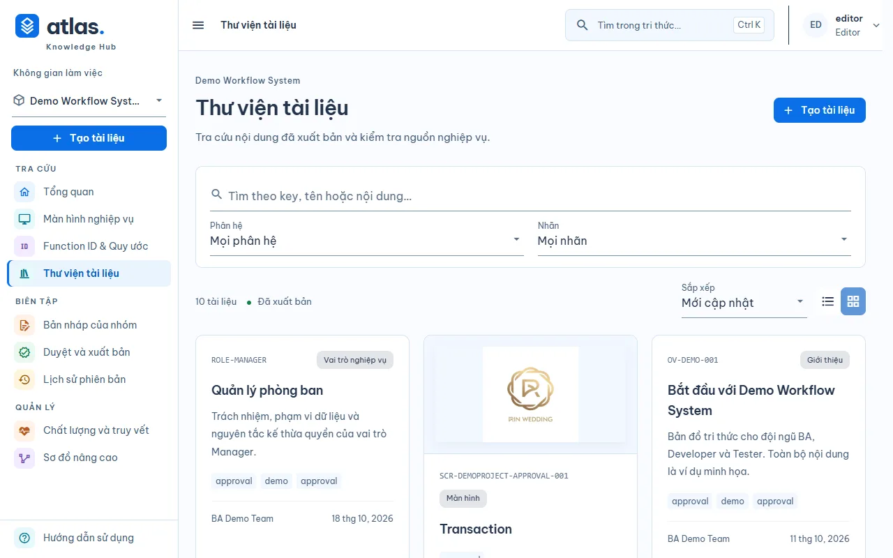

## 10. Tạo tài liệu mới

**Công dụng:** bắt đầu một tài liệu mới dưới dạng bản nháp. Chỉ nhóm biên tập thấy bản nháp, người đọc chưa thấy.

1. Bấm **Tạo tài liệu** ở đầu thanh bên (hoặc trên trang Tổng quan, Thư viện, Function ID).
2. Chọn **Loại tài liệu** (Màn hình, Chức năng, Quy tắc nghiệp vụ…).
3. Nhập **Tiêu đề**, chọn **Phân hệ**, nhập **Người phụ trách**.
4. Giữ **Mẫu nội dung** mặc định hoặc chọn mẫu của đội. Mẫu tạo sẵn các mục cần viết.
5. Bấm **Tạo bản nháp**. Trang biên tập mở ra với bản nháp mới.

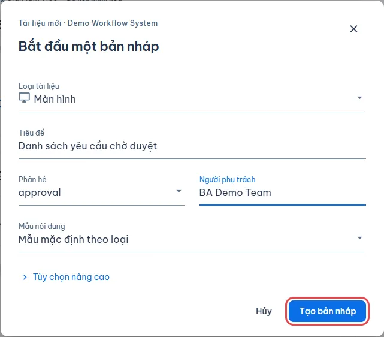

**Tùy chọn nâng cao** cho phép tự đặt **Document ID** và **Ngôn ngữ**. Để trống Document ID để hệ thống tự tạo mã. Ô nào thiếu sẽ được báo ngay bên dưới.

## 11. Soạn nội dung

**Công dụng:** viết và chỉnh nội dung tài liệu. Có ba chế độ xem cho cùng một nội dung.

1. Điền **Tiêu đề tài liệu**, **Người phụ trách**, **Phiên bản** và **Mô tả ngắn** ở đầu trang. Mở **Thông tin, liên kết và nguồn** để thêm ngày rà soát, ngày hiệu lực, tags và đường dẫn nguồn.
2. Chọn tab để soạn:
   - **Soạn thảo**: soạn trực quan với thanh công cụ (in đậm, tiêu đề, danh sách, bảng, code, liên kết, sơ đồ Mermaid, ảnh).
   - **Markdown Source**: sửa trực tiếp mã Markdown, tiện khi dán nội dung có sẵn.
   - **Xem trước**: xem tài liệu đúng như người đọc sẽ thấy.
3. Thay toàn bộ dòng mẫu như *"Điền nội dung đã được xác nhận tại đây"* bằng nội dung nghiệp vụ thật.

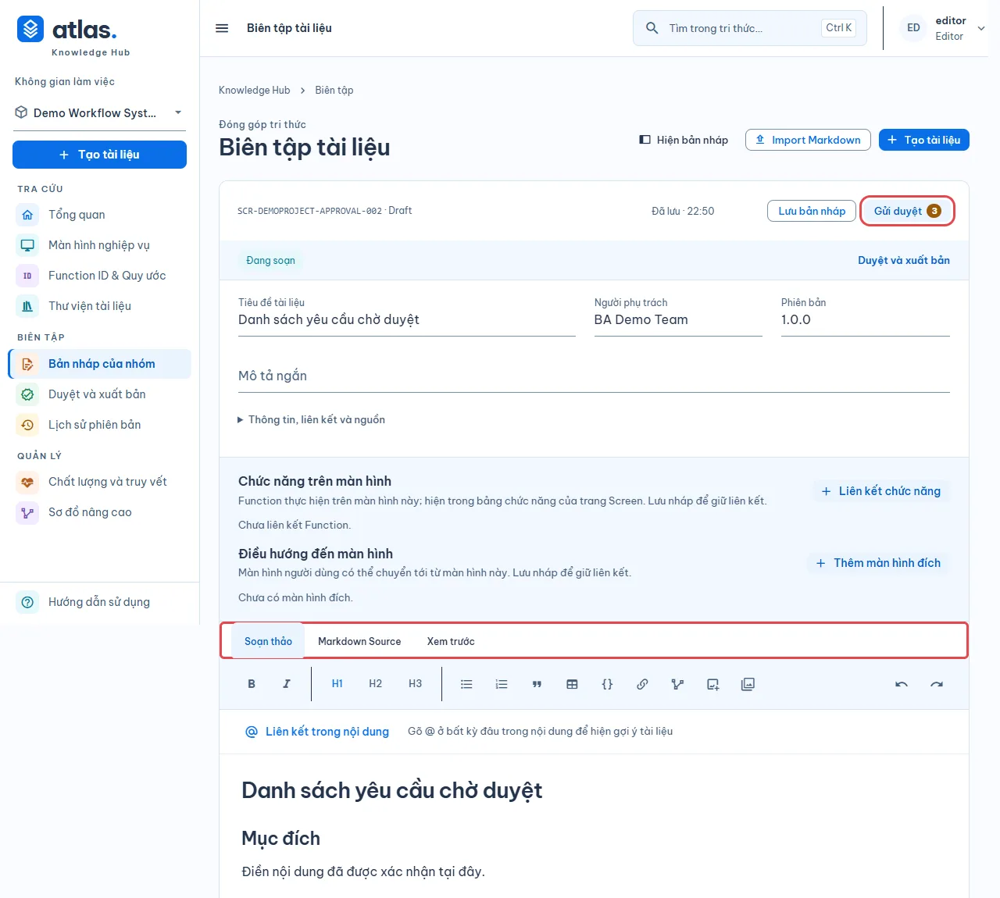

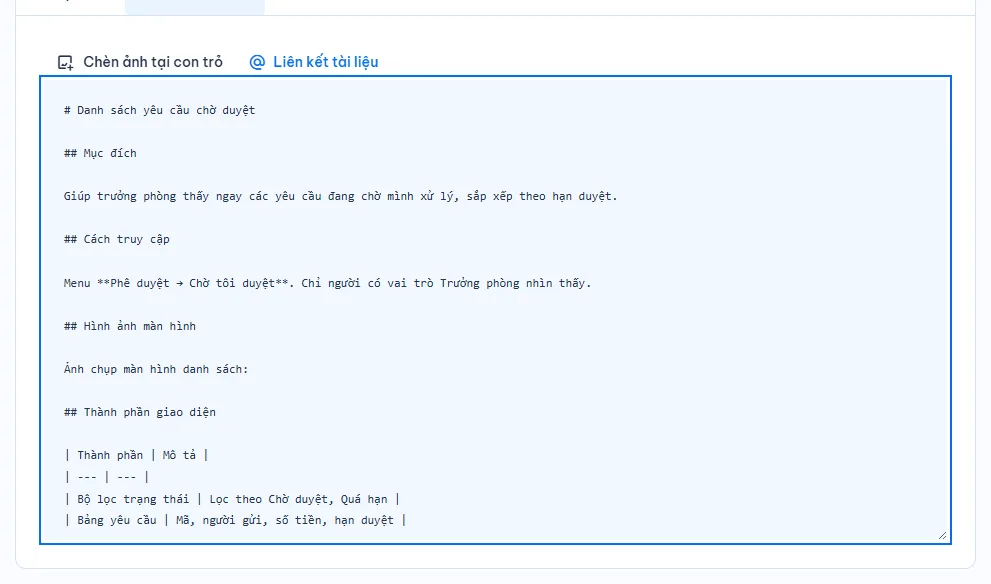

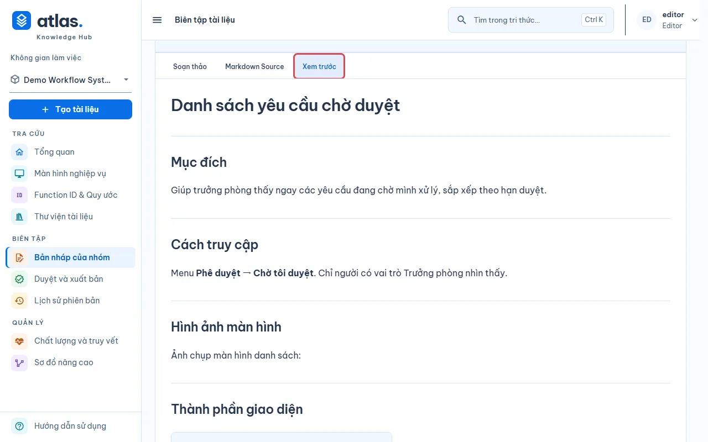

Nút **Import Markdown** ở đầu trang nhập nội dung từ file `.md`. Nút **Hiện bản nháp** mở danh sách bản nháp của nhóm để chuyển nhanh giữa các tài liệu.

### Panel, thu gọn, cột, trạng thái và HTML

Gõ trong **Markdown Source**, rồi mở **Xem trước** để kiểm tra. Ở tab **Soạn thảo**, mỗi block và khối HTML hiện thành một ô xem trước có nhãn *giữ nguyên khi lưu*: bấm **Sửa mã** để sửa mã của riêng khối đó, hoặc biểu tượng thùng rác để xóa. Thẻ HTML nằm giữa dòng (như `<span>`, `:status[…]`) hiện thành nhãn nhỏ màu xám; chữ xung quanh vẫn sửa bình thường.

```markdown
::: info Tiêu đề tùy chọn
Nội dung panel. Có thể dùng note, tip, warning, danger thay cho info.
:::

::: expand Xem chi tiết
Nội dung bị thu gọn, bấm tiêu đề để mở.
:::

:::: columns
::: column
Cột trái
:::
::: column
Cột phải
:::
::::

Trạng thái: :status[Đã duyệt]{green}
```

- Màu trạng thái: `grey`, `blue`, `green`, `yellow`, `red`, `purple`.
- Khi đặt block này trong block khác, block ngoài cần nhiều dấu `:` hơn block trong (ví dụ `::::` bọc `:::`).
- Dùng được mọi thẻ HTML, trừ thẻ có thể chạy mã hoặc giả giao diện: `<script>`, `<style>`, `<iframe>`, `<object>`, `<embed>`, `<svg>`, `<math>`, `<meta>`, `<link>`, `<base>`, `<form>`, `<input>`, `<button>`, `<dialog>`. Sự kiện `on…` (như `onclick`) và link `javascript:` / `data:` cũng bị chặn. Khi lưu, những thứ này làm lỗi; khi import, chúng được tự loại bỏ và hiện trong cảnh báo.
- Thuộc tính khác được tự bỏ, không làm lỗi. Giữ lại: `class` dạng `atlas-…`, `title`, `lang`, `dir`, `href`/`target` trên link, `src`/`alt`/`width`/`height` trên ảnh, `open` trên `<details>`, `colspan`/`rowspan`/`align` trên ô bảng.
- `style` giữ: `color`, `background-color`, `text-align`, `font-weight`, `font-style`, `text-decoration`, `vertical-align` và `font-size` từ 10px đến 72px. CSS khác (như `position`, `display`) được tự bỏ.
- HTML kiểu cũ được tự đổi: `<font color>` thành `<span style="color">`, `<center>` và `align="…"` thành `text-align`. Class `doc-callout--info/warning/success/danger` thành panel Atlas, `doc-details` thành khối thu gọn.

## 12. Chèn ảnh

**Công dụng:** thêm ảnh chụp màn hình hoặc hình minh họa ngay trong nội dung.

1. Đặt con trỏ ở chỗ muốn chèn ảnh.
2. Bấm nút **Chèn ảnh** trên thanh công cụ và chọn file. Cách khác: dán ảnh (Ctrl + V) hoặc kéo thả file vào nội dung, hoặc chọn ảnh đã tải lên trước đó trong **Thư viện ảnh tài liệu**.
3. Ảnh hiện ngay tại vị trí con trỏ. Bạn có thể gõ tiếp trong lúc ảnh đang tải lên.

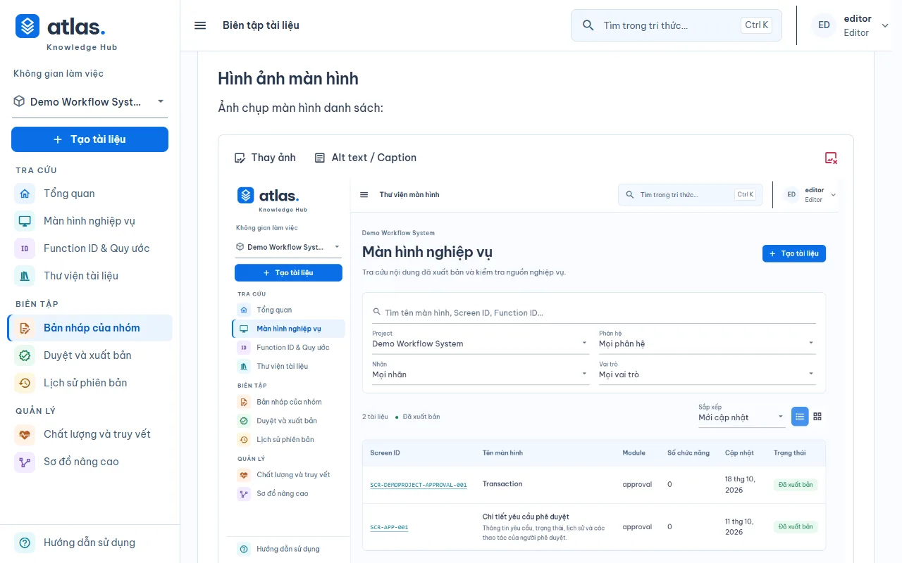

- Hỗ trợ PNG, JPEG và WebP, tối đa 10 MB mỗi ảnh.
- Trên khung ảnh: **Thay ảnh** để đổi file, **Alt text / Caption** để sửa mô tả, chú thích, căn lề và chiều rộng.
- Gỡ ảnh khỏi nội dung vẫn giữ file gốc trong kho.

## 13. Liên kết tài liệu bằng @

**Công dụng:** nhắc tới một tài liệu khác ngay trong câu văn. Người đọc bấm vào là mở tài liệu đó, và liên kết được tính vào phần **Được tham chiếu bởi** của tài liệu đích.

1. Gõ `@` ở đầu dòng, sau dấu cách hoặc sau dấu câu như `(`.
2. Gõ tiếp mã hoặc một phần tên để lọc, ví dụ `@BR-014` hoặc `@phe`. Từ khóa sau `@` không có dấu cách.
3. Dùng ↑ ↓ hoặc chuột để chọn, **Enter** để chèn, **Esc** để bỏ.

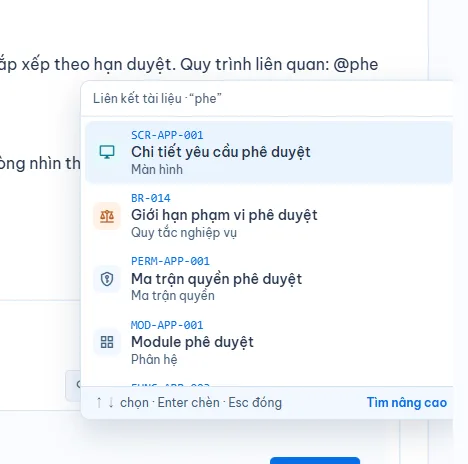

Nút **Liên kết trong nội dung** (hoặc **Liên kết tài liệu** trong Markdown Source) chèn sẵn `@` tại con trỏ. Cần lọc theo loại hoặc phân hệ thì chọn **Tìm nâng cao** ở cuối danh sách. Gõ `@` dính liền sau chữ (như email `ten@congty`) sẽ không mở gợi ý.

## 14. Liên kết chức năng cho màn hình

**Công dụng:** khai báo màn hình này có những chức năng nào. Các chức năng được liên kết sẽ hiện trong bảng chức năng của trang màn hình, kèm Trigger và Rule.

Loại tài liệu nào cần quan hệ gì thì chỉ hiện quan hệ đó:

- **Màn hình**: **Chức năng trên màn hình** và **Điều hướng đến màn hình** (màn hình người dùng có thể chuyển tới).
- **Chức năng**: **Quy tắc áp dụng** (hiện ở cột Rule trong bảng chức năng của màn hình).

Các bước, ví dụ với màn hình:

1. Trong bản nháp, bấm **Liên kết chức năng**.
2. Tìm theo tên hoặc mã. Bộ lọc **Phân hệ** và **Loại tài liệu** nằm ngay dưới ô tìm kiếm.
3. Bấm để chọn một hoặc nhiều chức năng, rồi bấm **Thêm liên kết**.
4. Lưu bản nháp để giữ liên kết.

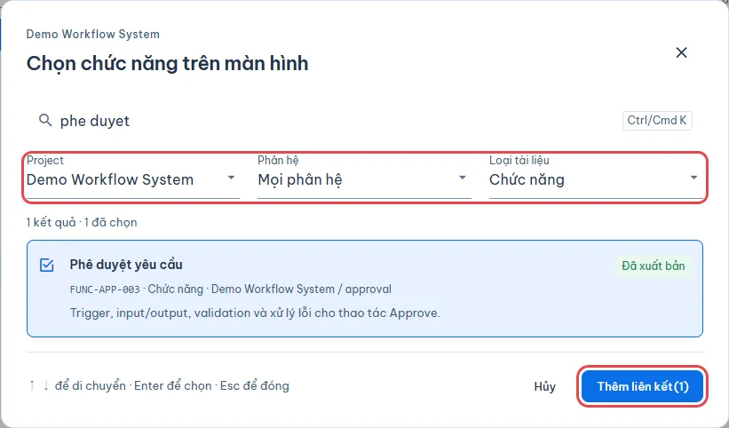

Nếu chưa có tài liệu phù hợp, bấm **Tạo tài liệu mới** trong hộp chọn để tạo nhanh một bản nháp và liên kết luôn.

## 15. Lưu bản nháp và gửi duyệt

**Công dụng:** lưu công việc đang làm và chuyển tài liệu cho người duyệt khi đã hoàn thiện.

1. Bấm **Lưu bản nháp**. Dòng **Đã lưu · giờ** cho biết lần lưu gần nhất.
2. Nếu nút **Gửi duyệt** có số màu cam, đó là số mục còn thiếu. Bấm vào để xem danh sách cần hoàn thiện.

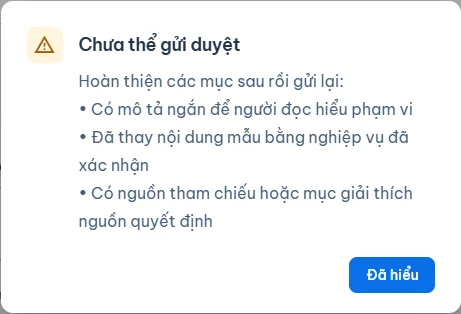

Một tài liệu đủ điều kiện gửi duyệt khi:

- có **Mô tả ngắn** và **Người phụ trách**;
- có ít nhất một mục nội dung (tiêu đề cấp 2);
- đã thay hết nội dung mẫu;
- có nguồn tham chiếu, hoặc một mục **Nguồn quyết định** trong nội dung;
- được phân loại nội bộ.

3. Khi số trên nút đã hết, bấm **Gửi duyệt**. Tài liệu chuyển sang trạng thái **Chờ duyệt**.

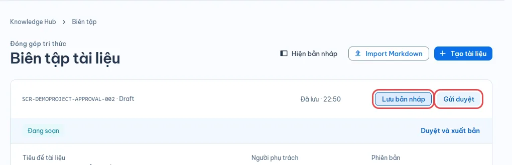

Thay đổi trong bản nháp chỉ đến được người đọc sau khi xuất bản thành công.

## 16. Duyệt và xuất bản

**Công dụng:** người duyệt kiểm tra thay đổi và phát hành một hoặc nhiều tài liệu liên quan cùng lúc.

1. Bấm **Duyệt và xuất bản** ở thanh bên. Lọc theo **Trạng thái** nếu cần.
2. Ở dòng tài liệu cần duyệt, bấm **Đối chiếu**.

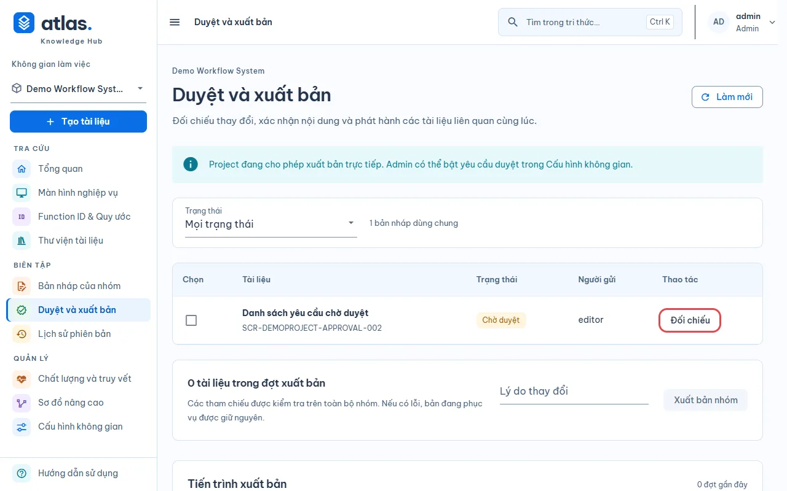

3. Hộp đối chiếu đặt **Bản đã xuất bản** cạnh **Bản gửi duyệt**, kèm checklist. Ghi nhận xét nếu cần, rồi bấm **Duyệt phiên bản này** hoặc **Yêu cầu sửa**.

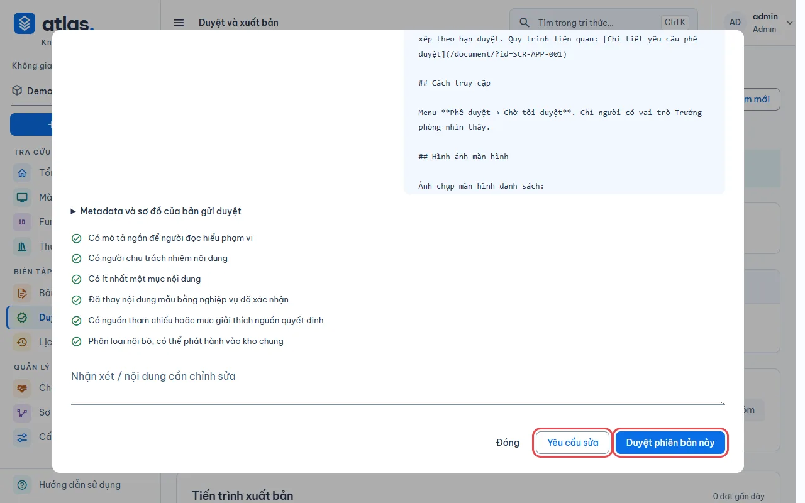

4. Tích chọn các tài liệu cần phát hành, nhập **Lý do thay đổi**, rồi bấm **Xuất bản nhóm**. Có thể xuất bản cùng lúc các tài liệu tham chiếu lẫn nhau.

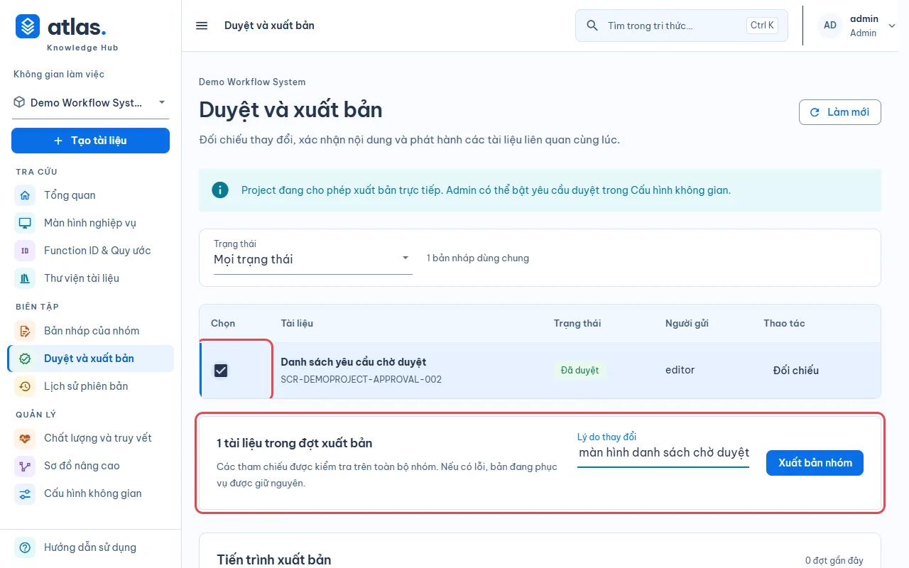

5. Theo dõi khung **Tiến trình xuất bản** đến khi hiện **Hoàn tất**.

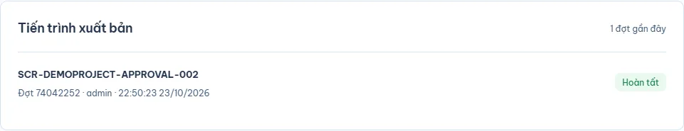

Sau khi xuất bản, tài liệu hiện với người đọc, kèm tên người xác nhận và ngày xác nhận.

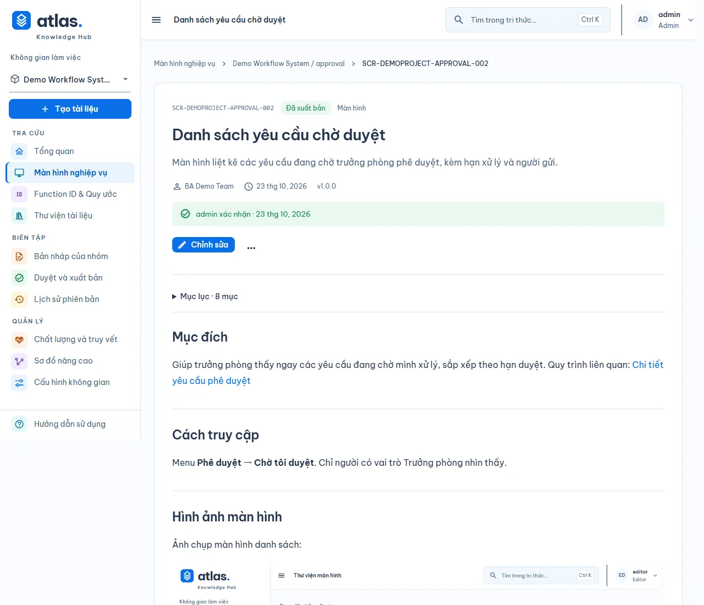

Lưu ý:

- Project bật **Yêu cầu người khác duyệt trước khi xuất bản** thì người duyệt phải khác người gửi. Project không bật thì Publisher và Admin có thể xuất bản trực tiếp; trang hiện dòng thông báo màu xanh để nhắc điều này.
- Sửa tài liệu hoặc sơ đồ sau khi đã duyệt thì cần duyệt lại.
- Nếu xuất bản thất bại, xem lỗi trong khung tiến trình. Bản đang phục vụ người đọc vẫn được giữ nguyên.

## 17. Lịch sử phiên bản

**Công dụng:** xem ai đã xuất bản gì, khi nào, và quay lại một phiên bản cũ khi cần.

1. Bấm **Lịch sử phiên bản** ở thanh bên (hoặc **…** → **Lịch sử phiên bản** trong trang tài liệu).
2. Chọn tài liệu ở ô **Tài liệu**.
3. Mỗi dòng là một lần xuất bản, kèm lý do, người thực hiện và thời gian.
   - **Xem diff**: so sánh phiên bản với phiên bản trước (khi tài liệu có từ hai phiên bản).
   - **Khôi phục** (Publisher, Admin): tạo một phiên bản mới có nội dung của phiên bản đã chọn. Lịch sử cũ vẫn được giữ.
4. **Gỡ xuất bản** ẩn tài liệu khỏi người đọc mà không xóa lịch sử.

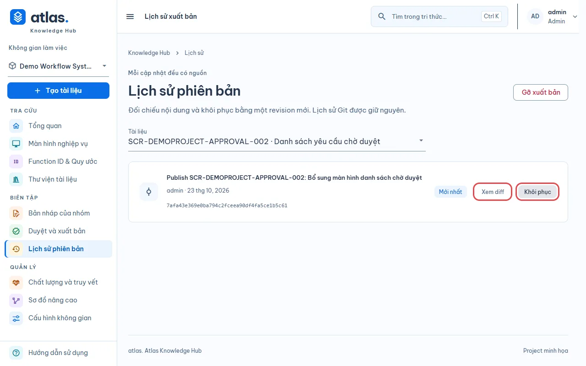

Project bật yêu cầu duyệt thì bản khôi phục cũng cần duyệt lại trước khi phát hành.

## 18. Sơ đồ nâng cao

**Công dụng:** vẽ sơ đồ luồng nghiệp vụ, điều hướng màn hình hoặc vai trò bằng cách kéo thả, gắn với một tài liệu.

1. Bấm **Sơ đồ nâng cao** ở thanh bên.
2. Chọn **Tài liệu** và **Diagram**, hoặc bấm **Sơ đồ mới** để tạo sơ đồ mới cho tài liệu.
3. Chọn loại node (action, decision…) rồi bấm **Thêm node**. Kéo node để bố trí, nối hai điểm kết nối để tạo nhánh.
4. Bấm vào node hoặc đường nối để sửa thông tin ở khung **Chi tiết sơ đồ** bên phải.
5. Bấm **Lưu bản nháp**. Sơ đồ đi theo tài liệu qua bước duyệt và xuất bản.

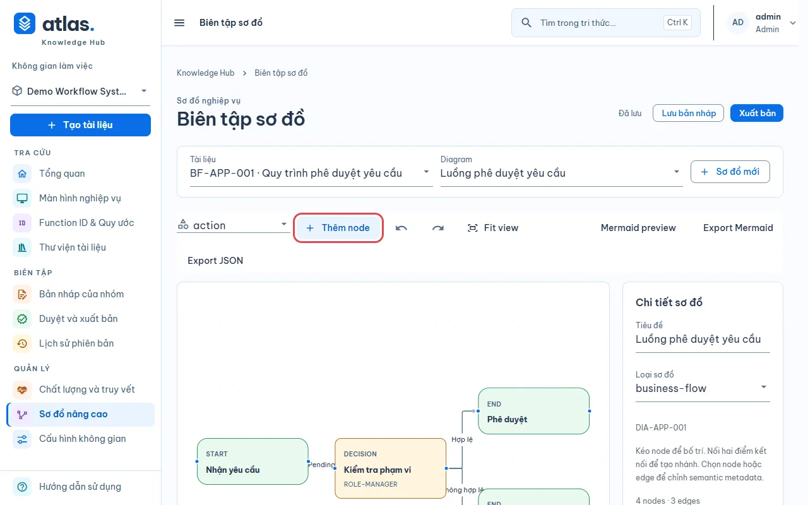

**Fit view** đưa toàn bộ sơ đồ vào khung nhìn. **Mermaid preview**, **Export Mermaid** và **Export JSON** dùng để xem hoặc lấy sơ đồ ra ngoài.

## 19. Chất lượng và truy vết

**Công dụng:** kiểm tra sức khỏe kho tri thức: tài liệu nào chưa được liên kết, quá hạn rà soát, tham chiếu tới tài liệu không tồn tại, và các góp ý của người đọc.

1. Bấm **Chất lượng và truy vết** ở thanh bên.
2. Xem bốn chỉ số ở trên cùng: tài liệu đã xuất bản, chưa kết nối, quá hạn rà soát, tham chiếu chưa tồn tại.
3. Chuyển giữa các tab:
   - **Ma trận liên kết**: tài liệu nào liên kết tới tài liệu nào.
   - **Cần rà soát**: tài liệu đã quá ngày cần rà soát.
   - **Chưa kết nối**: tài liệu chưa có liên kết nào.
4. Kéo xuống phần **Góp ý nội dung** để xử lý góp ý của người đọc.

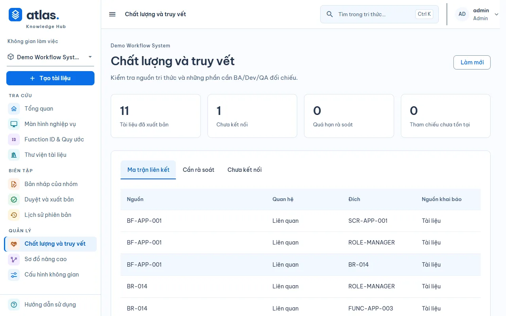

## 20. Cấu hình không gian (Admin)

**Công dụng:** quản lý project, phân hệ, mẫu tài liệu và các quy định chung của không gian.

1. Bấm **Cấu hình không gian** ở thanh bên.
2. Trong **Không gian và project**:
   - đổi tên không gian;
   - chọn tài liệu quy ước Function ID mặc định;
   - chọn project để sửa tên hiển thị và mô tả;
   - bật hoặc tắt **Yêu cầu người khác duyệt trước khi xuất bản**;
   - thiết lập **Function ID · Bảng mã được duyệt**.
3. Thêm phân hệ ở mục **Phân hệ**. Thêm project bằng **Thêm project**. Thêm mẫu ở mục **Mẫu tài liệu** để thống nhất cấu trúc tài liệu của đội.
4. Bấm **Lưu cấu hình**. Bấm **Tải lại** để bỏ các thay đổi chưa lưu.

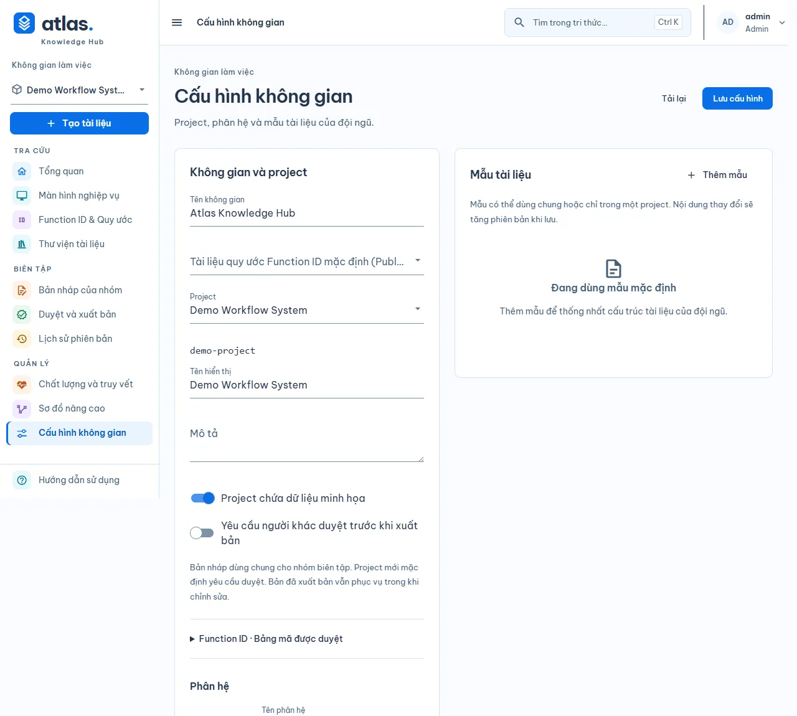

## 21. Lưu ý khi làm việc nhóm

- Bản nháp dùng chung cho cả nhóm biên tập. Nếu người khác đang mở cùng bản nháp, thanh trạng thái hiện tên họ. Đây chỉ là cảnh báo, không khóa bản nháp.
- Khi có xung đột (người khác đã lưu trước bạn), chọn **Đối chiếu** hoặc **Export thay đổi** để giữ nội dung của bạn trước khi **Tải lại bản mới**.
- Test Scenario cũ chỉ còn để tra cứu và export tại trang `/legacy/`, không tạo hoặc sửa mới.
- Khi một trang tải lâu, thanh mảnh ở mép trên và khung xám giữ chỗ cho biết nội dung đang được tải.
